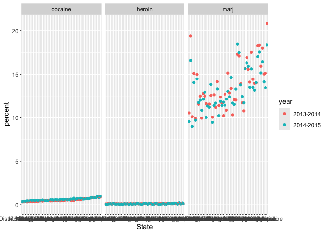

Iteration + List Cols
================

``` r
library(tidyverse)
library(rvest)
library(p8105.datasets)

source("source/nsduh_process.R")
source("source/mean_and_sd.R")

set.seed(1236)
```

## Lists!

Prove that lists can have anything

``` r
l = list(
  vec_numeric = 5:17,
  mat = matrix(1:8, nrow = 2, ncol = 4, byrow = TRUE),
  vec_logical = c(TRUE),
  summary_table = summary(rnorm(1000))
)

l
```

    ## $vec_numeric
    ##  [1]  5  6  7  8  9 10 11 12 13 14 15 16 17
    ## 
    ## $mat
    ##      [,1] [,2] [,3] [,4]
    ## [1,]    1    2    3    4
    ## [2,]    5    6    7    8
    ## 
    ## $vec_logical
    ## [1] TRUE
    ## 
    ## $summary_table
    ##      Min.   1st Qu.    Median      Mean   3rd Qu.      Max. 
    ## -2.866342 -0.637111 -0.002336  0.003323  0.658024  3.265081

``` r
l[[1]]
```

    ##  [1]  5  6  7  8  9 10 11 12 13 14 15 16 17

``` r
l[["vec_logical"]]
```

    ## [1] TRUE

``` r
l$summary_table
```

    ##      Min.   1st Qu.    Median      Mean   3rd Qu.      Max. 
    ## -2.866342 -0.637111 -0.002336  0.003323  0.658024  3.265081

## `for` loops

``` r
list_norm = list(
  a = rnorm(20, 3, 4),
  b = rnorm(20, -14, 20),
  c = rnorm(20, 1000, 10),
  d = rnorm(20, 0, 1)
)
```

Can I get mean and SD for each sample

``` r
mean_and_sd(list_norm[[1]])
```

    ## # A tibble: 1 × 2
    ##    mean    sd
    ##   <dbl> <dbl>
    ## 1  2.94  3.32

``` r
mean_and_sd(list_norm[[2]])
```

    ## # A tibble: 1 × 2
    ##    mean    sd
    ##   <dbl> <dbl>
    ## 1 -9.22  22.7

``` r
mean_and_sd(list_norm[[3]])
```

    ## # A tibble: 1 × 2
    ##    mean    sd
    ##   <dbl> <dbl>
    ## 1 1000.  6.65

``` r
mean_and_sd(list_norm[[4]])
```

    ## # A tibble: 1 × 2
    ##      mean    sd
    ##     <dbl> <dbl>
    ## 1 -0.0560  1.09

Annoying to have them all separate – do this better so it’s quicker/more
efficient

``` r
output = vector("list", length = 4)

for (i in 1:4) {
  
  output[[i]] = mean_and_sd(list_norm[[i]])
  
}
```

## `map` instead

This is better!

``` r
output = map(list_norm, mean_and_sd)

output = map(list_norm, median)
```

What about map variants

``` r
output = map_dbl(list_norm, median)
output = map_df(list_norm, mean_and_sd)
```

## LIST COLUMNS LFG

``` r
listcol_df = 
  tibble(
    name = c("a", "b", "c", "d"),
    samp = list_norm
  )
```

Do stuff with this

``` r
listcol_df |>
  filter(name %in% c("a", "c", "d"))
```

    ## # A tibble: 3 × 2
    ##   name  samp        
    ##   <chr> <named list>
    ## 1 a     <dbl [20]>  
    ## 2 c     <dbl [20]>  
    ## 3 d     <dbl [20]>

``` r
listcol_df |>
  pull(samp)
```

    ## $a
    ##  [1]  0.9159114  3.9351002  0.4542432 -2.2204479  6.8932190  5.1244742
    ##  [7]  3.0167339  1.2722880  2.2738587  1.3975934  0.2412513  8.7954751
    ## [13]  5.4102001  5.6806398  1.4349576  7.7910554  1.3815394  3.9662007
    ## [19]  5.5049290 -4.4350801
    ## 
    ## $b
    ##  [1] -38.8273125 -17.3048465 -37.0491490 -10.9662495 -13.8820017 -42.4692825
    ##  [7]  24.9015607  10.7117280  -1.2350787 -11.9174419  16.2479180  23.7679930
    ## [13] -10.8558799  -2.3840318 -27.5021477 -11.0160255  -0.9578981 -54.7284315
    ## [19]  -0.6934327  21.7843104
    ## 
    ## $c
    ##  [1]  991.9421 1003.8966  999.7477  986.6911 1003.8306 1005.0120  996.4603
    ##  [8] 1002.0745 1000.0843 1010.2073 1003.9050  995.3473 1012.8874 1000.4635
    ## [15]  998.9534 1007.7798  990.1145 1003.4437  995.1758  995.0738
    ## 
    ## $d
    ##  [1]  1.95387846 -0.05245400 -0.46954531  0.07402405 -1.58979325 -1.30688268
    ##  [7] -1.10632794 -0.56723500 -0.41408053  0.92099945  1.44702754  1.99236409
    ## [13] -0.55596915 -0.28278326  0.08300015  1.09988202 -1.89214254  0.10662779
    ## [19]  0.16717212 -0.72687919

what about mean and sd

``` r
mean_and_sd(pull(listcol_df, samp)[[1]])
```

    ## # A tibble: 1 × 2
    ##    mean    sd
    ##   <dbl> <dbl>
    ## 1  2.94  3.32

Can I iterate?

``` r
map(pull(listcol_df, samp), mean_and_sd)
```

    ## $a
    ## # A tibble: 1 × 2
    ##    mean    sd
    ##   <dbl> <dbl>
    ## 1  2.94  3.32
    ## 
    ## $b
    ## # A tibble: 1 × 2
    ##    mean    sd
    ##   <dbl> <dbl>
    ## 1 -9.22  22.7
    ## 
    ## $c
    ## # A tibble: 1 × 2
    ##    mean    sd
    ##   <dbl> <dbl>
    ## 1 1000.  6.65
    ## 
    ## $d
    ## # A tibble: 1 × 2
    ##      mean    sd
    ##     <dbl> <dbl>
    ## 1 -0.0560  1.09

super coolness incoming

``` r
listcol_df |>
  mutate(
    output = map(samp, mean_and_sd)
  )
```

    ## # A tibble: 4 × 3
    ##   name  samp         output          
    ##   <chr> <named list> <named list>    
    ## 1 a     <dbl [20]>   <tibble [1 × 2]>
    ## 2 b     <dbl [20]>   <tibble [1 × 2]>
    ## 3 c     <dbl [20]>   <tibble [1 × 2]>
    ## 4 d     <dbl [20]>   <tibble [1 × 2]>

``` r
listcol_df |>
  mutate(
    output = map_df(samp, mean_and_sd)
  )
```

    ## # A tibble: 4 × 3
    ##   name  samp         output$mean   $sd
    ##   <chr> <named list>       <dbl> <dbl>
    ## 1 a     <dbl [20]>        2.94    3.32
    ## 2 b     <dbl [20]>       -9.22   22.7 
    ## 3 c     <dbl [20]>     1000.      6.65
    ## 4 d     <dbl [20]>       -0.0560  1.09

``` r
listcol_df |>
  mutate(
    output = map_dbl(samp, median)
  )
```

    ## # A tibble: 4 × 3
    ##   name  samp           output
    ##   <chr> <named list>    <dbl>
    ## 1 a     <dbl [20]>      2.65 
    ## 2 b     <dbl [20]>    -10.9  
    ## 3 c     <dbl [20]>   1000.   
    ## 4 d     <dbl [20]>     -0.168

## Another Example

NSDUH Import etc

``` r
nsduh_url = "https://www.samhsa.gov/data/sites/default/files/NSDUHsaeShortTermCHG2015/NSDUHsaeShortTermCHG2015.htm"

nsduh_html = read_html(nsduh_url)

nsduh_process(html = nsduh_html, table_num = 1)
```

    ## # A tibble: 510 × 4
    ##    State   age   year      percent
    ##    <chr>   <chr> <chr>       <dbl>
    ##  1 Alabama 12+   2013-2014    9.98
    ##  2 Alabama 12+   2014-2015    9.6 
    ##  3 Alabama 12-17 2013-2014    9.9 
    ##  4 Alabama 12-17 2014-2015    9.71
    ##  5 Alabama 18-25 2013-2014   27.0 
    ##  6 Alabama 18-25 2014-2015   26.1 
    ##  7 Alabama 26+   2013-2014    7.1 
    ##  8 Alabama 26+   2014-2015    6.81
    ##  9 Alabama 18+   2013-2014    9.99
    ## 10 Alabama 18+   2014-2015    9.59
    ## # ℹ 500 more rows

``` r
nsduh_process(html = nsduh_html, table_num = 4)
```

    ## # A tibble: 510 × 4
    ##    State   age   year      percent
    ##    <chr>   <chr> <chr>       <dbl>
    ##  1 Alabama 12+   2013-2014    1.23
    ##  2 Alabama 12+   2014-2015    1.22
    ##  3 Alabama 12-17 2013-2014    0.42
    ##  4 Alabama 12-17 2014-2015    0.41
    ##  5 Alabama 18-25 2013-2014    3.09
    ##  6 Alabama 18-25 2014-2015    3.2 
    ##  7 Alabama 26+   2013-2014    1.01
    ##  8 Alabama 26+   2014-2015    0.99
    ##  9 Alabama 18+   2013-2014    1.31
    ## 10 Alabama 18+   2014-2015    1.31
    ## # ℹ 500 more rows

``` r
nsduh_process(html = nsduh_html, table_num = 5)
```

    ## # A tibble: 510 × 4
    ##    State   age   year      percent
    ##    <chr>   <chr> <chr>       <dbl>
    ##  1 Alabama 12+   2013-2014    0.22
    ##  2 Alabama 12+   2014-2015    0.27
    ##  3 Alabama 12-17 2013-2014    0.1 
    ##  4 Alabama 12-17 2014-2015    0.08
    ##  5 Alabama 18-25 2013-2014    0.45
    ##  6 Alabama 18-25 2014-2015    0.64
    ##  7 Alabama 26+   2013-2014    0.19
    ##  8 Alabama 26+   2014-2015    0.23
    ##  9 Alabama 18+   2013-2014    0.23
    ## 10 Alabama 18+   2014-2015    0.29
    ## # ℹ 500 more rows

Import using iteration

``` r
output = vector("list", length = 3)

table_nums = c(1, 4, 5)

for (i in 1:3) {
  
  output[[i]] = nsduh_process(html = nsduh_html, table_num = table_nums[i])
  
}
```

let’s build up a map example

``` r
output = map(table_nums, nsduh_process, html = nsduh_html)
```

now we try list columns

``` r
nsduh_df = 
  tibble(
    drug = c("marj", "cocaine", "heroin"),
    num = c(1, 4, 5)
  ) |>
  mutate(
    table = map(num, nsduh_process, html = nsduh_html)
  ) |>
  select(-num) |>
  unnest(table)

nsduh_df |>
  filter(age == "12-17")|>
  mutate(State = fct_reorder(State, percent)) |>
  ggplot(aes(x = State, y = percent, color = year)) +
  geom_point() +
  facet_grid(. ~ drug)
```

<!-- -->

- Takeaways include understanding the mutate by mapping and
  selecting/unnesting functions
